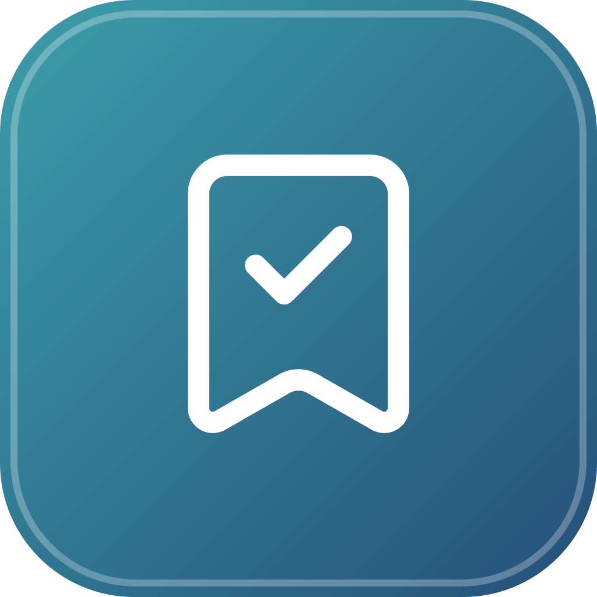
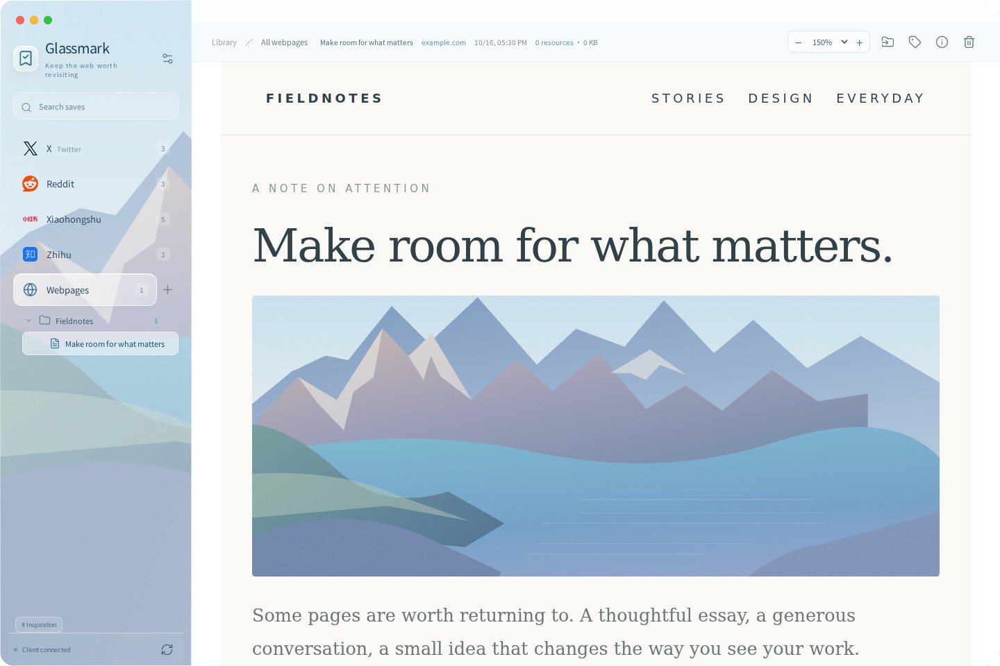
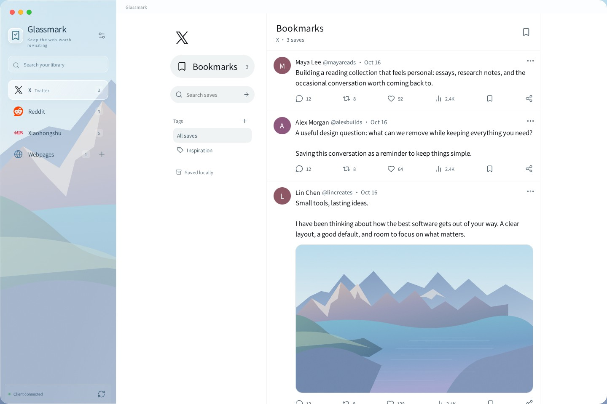
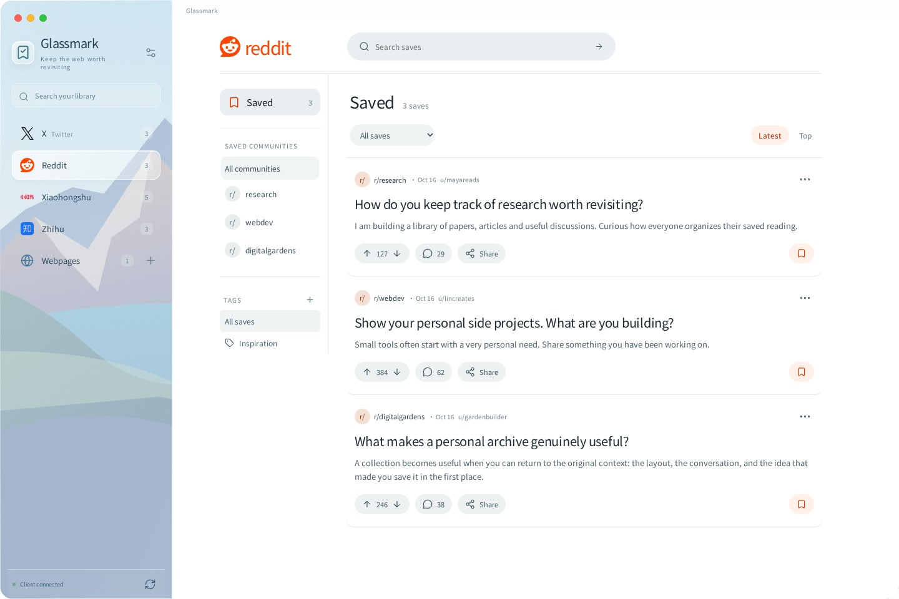
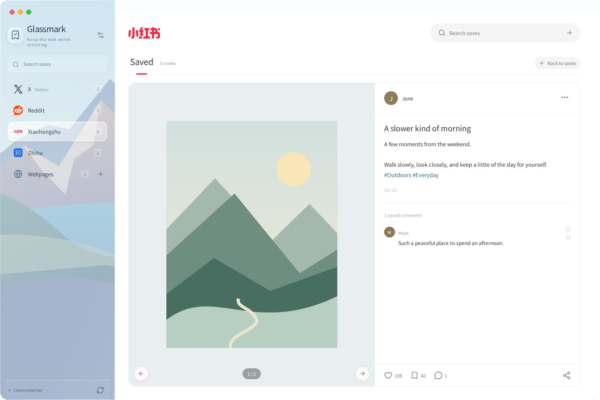
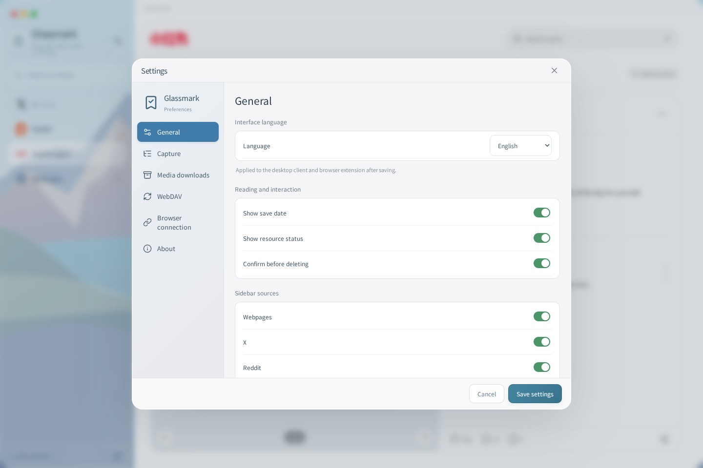
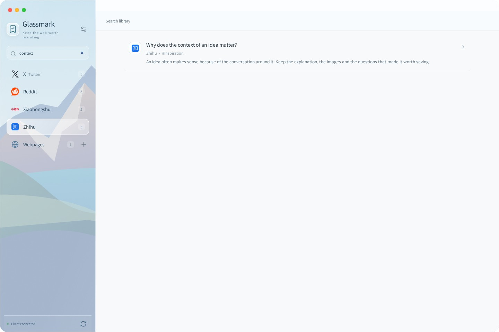

<h1 align="center">Glassmark</h1>

<a href="https://github.com/kevinhuang001/bookmark-web/releases/latest">Download Glassmark</a> · <a href="#get-started">Get started</a> · <a href="README.zh-CN.md">简体中文</a> · <a href="README.ja.md">日本語</a>

 

## More than a link

An article you want to return to. A thread that explains something well. A note that sparks an idea. Glassmark keeps the content, images and supported videos together, so the things you save remain useful when you come back.

- **Read without the surrounding noise.** Saved webpages fill the reading pane, with their layout and typography preserved.
- **Keep the conversation.** Save X threads, Reddit discussions, Xiaohongshu notes and Zhihu answers with their loaded replies, comments and media.
- **Make it yours.** Organize pages into nested folders, add tags, search across your library, and choose which sources appear in the sidebar.
- **Own your library.** Store content locally and sync through a chosen local folder or your own WebDAV server. No Glassmark account is required.
- **Feel at home.** A softly frosted desktop interface for macOS, Windows and Linux, with English, 简体中文 and 日本語 UI.

## A familiar place for every save

### Webpages, with room to read

Keep whole pages or select several regions from a page. Read the saved content in a dedicated pane; its title, source and resource details stay within reach. Zoom each saved page from 50% to 200%; the app remembers its scale. Use the toolbar or ⌘/Ctrl + `+` / `−`, and ⌘/Ctrl + `0` to reset.

### X, focused on bookmarks

A familiar timeline for your saved posts and threads. Open a conversation, filter by author, or search just your X collection. Capture requires a specific post URL: one main post per save, with loaded replies. Feeds, preceding posts, marked ads and recommendation sections are excluded. Every exposed photo and video is archived separately, including attachments that load later.

Saved replies connect to known parents with avatar-gutter lines. Comment buttons expand saved replies in place. Comment media starts as small thumbnails; click to open an image or video, then use the arrows or arrow keys to browse that gallery.

### Reddit, focused on saved discussions

Browse your saved posts by community, sort the collection, and read archived comments in their original hierarchy.

### Xiaohongshu, focused on the notes you love

Browse a cover-first collection. Open a note to view its images and videos on the left, with text and saved comments on the right. Capture reads the current note's exposed media list and visits virtual gallery slides, including images beyond the one visible when you start.

### Zhihu, focused on answers worth revisiting

Keep individual answers and column articles in a clean, blue-accented collection. Read the full saved text, archived media and loaded comments without recommendations. On question or answer pages, select one answer in the extension; Glassmark opens its comments and waits for them to load. Column articles at `zhuanlan.zhihu.com/p/…` save directly.

### Your language, across the app and extension

Choose **Settings → General → Language**. Follow your system language or select English, Simplified Chinese or Japanese. The browser extension follows the desktop client's choice. Your saved content, folder names and custom tags stay in their original language.

Use **⌘/Ctrl + K** to search your library and **Escape** to return from a saved discussion to its collection. Empty searches offer a one-click reset, and keyboard focus remains visible throughout the interface.

*Screenshots show the application with sample content.*

## Get started

### 1. Download the desktop app

Choose your installer from the [latest release](https://github.com/kevinhuang001/bookmark-web/releases/latest).

| Platform | Download |
| --- | --- |
| macOS · Apple Silicon and Intel | Universal `.dmg` |
| Windows · x64 | `.exe` installer or `.msi` |
| Ubuntu / Debian · x64 | `.deb` |
| Fedora / openSUSE · x64 | `.rpm` |
| Arch / EndeavourOS / Manjaro · x64 | `.pkg.tar.zst` |
| Other Linux desktops · x64 | `.AppImage` |

Linux packages include the desktop launcher and application icon. Install with `sudo apt install ./Glassmark*.deb`, `sudo dnf install ./Glassmark*.rpm` (or `sudo zypper install ./Glassmark*.rpm`), or `sudo pacman -U ./glassmark-*.pkg.tar.zst`. Adjust the filename to the downloaded asset. Arch packages are built with `makepkg`; no AUR listing is required. Linux x64 binaries are built on Ubuntu 24.04 and require glibc 2.39 or newer plus WebKitGTK 4.1. Older enterprise distributions are not covered by these packages.

Release assets contain installers, extension ZIPs and `SHA256SUMS.txt`. Automated test reports are available in the linked [CI run artifacts](https://github.com/kevinhuang001/bookmark-web/actions), rather than the download list.

### 2. Add the browser extension

The same release includes **glassmark-chromium.zip** and **glassmark-firefox.zip**.

- **Chrome, Edge and other Chromium browsers:** unzip the package, open the browser's extension manager, enable Developer mode, then choose **Load unpacked** and select the extracted folder.
- **Firefox:** open `about:debugging` → **This Firefox** → **Load Temporary Add-on**, then select the extension's `manifest.json` or ZIP. Temporary add-ons must be loaded again after restarting Firefox.

### 3. Connect and save

1. Open Glassmark, then **Settings → Browser connection**.
2. Copy the pairing code and paste it into the extension.
3. Open a webpage or a post's detail page and click the extension to save it.
4. Return to Glassmark to read, search and organize your collection.

Keep the desktop client running while saving. Pairing codes are valid for five minutes.

## Built around your library

**Local media.** Images, avatars, GIFs and supported videos are stored alongside your saves. Download limits, concurrency and timeouts are configurable in Settings.

**Choose your sync method.** In **Settings → Sync**, select Local folder or WebDAV, configure its destination and save. There is no extra enable switch. Local folder displays the actual default archive path. Content is always stored locally, including when WebDAV is selected. A custom local folder is mirrored before WebDAV sync. Sync runs in the background; the bottom-left status shows progress, completion or Not synced, and failures keep the WebDAV selection. WebDAV keeps its automatic interval, Sync now and Sync conflicts inside its configuration card. Both methods use one `glassmark/` directory under the destination. All settings categories share the same grouped-card layout. See the [user guide](docs/USER-GUIDE.md) for details.

**Clear capture boundaries.** X can load replies within configurable time and post limits. Reddit and Xiaohongshu save the comments already loaded on the page. Direct MP4/WebM and unencrypted, finite HLS video are supported; live streams, DRM and unavailable media cannot be preserved. Each capture includes a resource report. The reply-count limit applies across structured social captures. Media availability depends on what the page exposes to your session. Previously missed attachments require a new capture; an update cannot recover files that were never saved.

## Open source

Glassmark is built with Tauri and a Rust local service. The code is available under the [MIT license](LICENSE).

[User guide](docs/USER-GUIDE.md) · [Contributing](CONTRIBUTING.md) · [Architecture](docs/ARCHITECTURE.md) · [Localization](docs/I18N.md) · [Report an issue](https://github.com/kevinhuang001/bookmark-web/issues)

Desktop installers and extension ZIPs are distributed through GitHub Releases. The macOS app is ad-hoc signed; Windows packages and Firefox add-ons are not store-signed. Glassmark is an independent project and is not affiliated with the platforms it supports.

## Resolve sync conflicts

Concurrent WebDAV edits retain their causal branches instead of being silently overwritten by a newer device clock. Open **Settings → Sync → WebDAV → Sync conflicts** to compare the title, folder, tags and deletion state, then choose a version. If versions differ only in tags, merge all tags. Deletion versus editing stays visible until you decide. Resolutions sync to other devices and remain effective after restarting. Stale resolution choices are rejected and refreshed.
