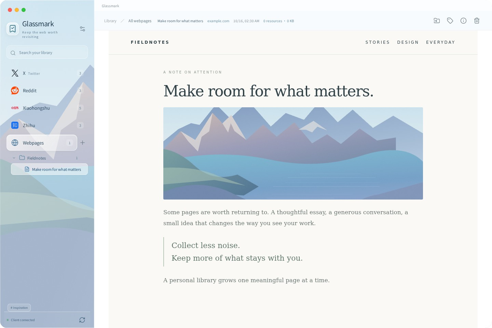
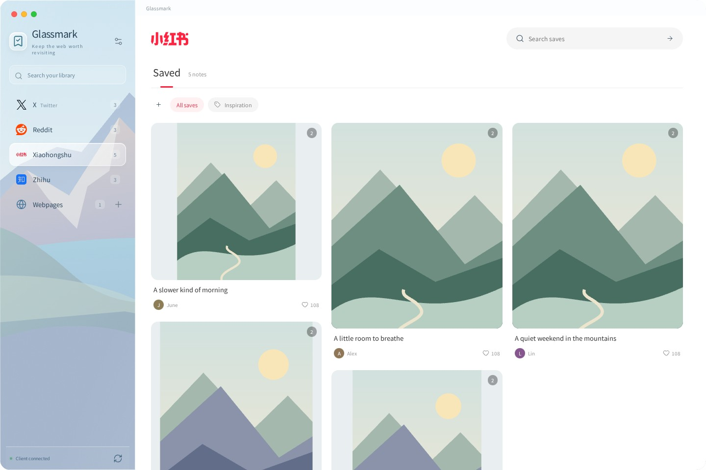
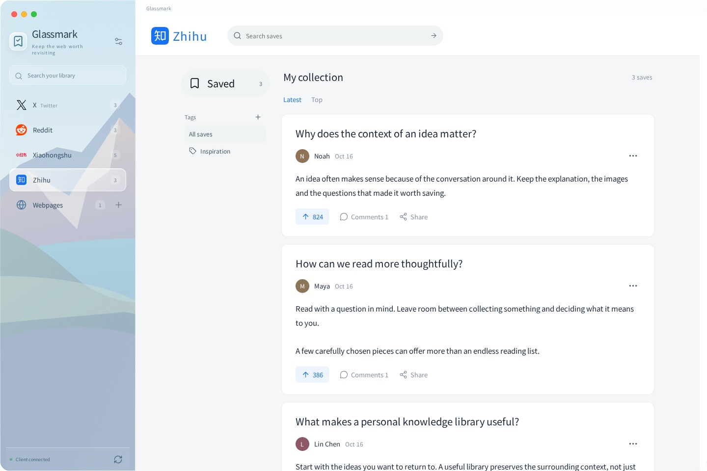

# Glassmark

**把值得回看的内容，留在手边。**

[下载最新版](https://github.com/kevinhuang001/bookmark-web/releases/latest) · [English](README.md) · [日本語](README.ja.md)

Glassmark 是一个本地优先的网页与帖子收藏工具。保存正文、对话和媒体，在安静的界面里慢慢阅读。

## 收藏之后，依然好读

- **网页沉浸阅读**：保存整页或多个选区，保留排版，把空间留给正文。
- **熟悉的平台界面**：X 书签时间线、Reddit 社区与层级评论、小红书封面瀑布流与双栏阅读、知乎回答与专栏文章阅读。
- **内容保存在本机**：图片、头像、GIF 和支持的视频一起归档，不只是留下一个链接。
- **整理和查找**：嵌套文件夹、独立标签、全局搜索与平台内搜索。
- **自己的同步服务**：可选 WebDAV 同步，无需注册 Glassmark 账户。
- **多语言界面**：英语、简体中文和日语，可跟随系统。扩展跟随客户端语言，收藏内容保持原文。

知乎请先打开回答的独立链接或专栏文章，再收藏正文、媒体和已加载评论。使用 ⌘/Ctrl + K 搜索，Esc 返回平台收藏列表。

## 开始使用

1. 在[发布页](https://github.com/kevinhuang001/bookmark-web/releases/latest)下载 macOS、Windows 或 Linux 客户端和对应浏览器扩展。
2. 启动客户端，打开「设置 → 浏览器连接」，复制配对码。
3. 在扩展中粘贴配对码，然后打开网页或帖子详情页进行收藏。
4. 回到客户端阅读、搜索、编辑标签和整理文件夹。

Chromium 扩展解压后通过扩展管理页的开发者模式加载。Firefox 通过 `about:debugging` 临时加载，重启浏览器后需要重新加载。收藏期间保持客户端运行。

在「设置 → 通用 → 语言」切换界面语言。下载上限、并发数、回复加载时间和 WebDAV 也可在设置中配置。

保存范围以页面已经加载和能够访问的内容为准。支持直接 MP4/WebM 及未加密的有限 HLS 点播；不支持 DRM 和直播完整归档。每次收藏可查看媒体保存报告。

截图使用示例内容。更完整的安装和产品介绍见 [English README](README.md)。

[使用指南](docs/USER-GUIDE.md) · [参与开发](CONTRIBUTING.md) · [MIT 许可](LICENSE)
