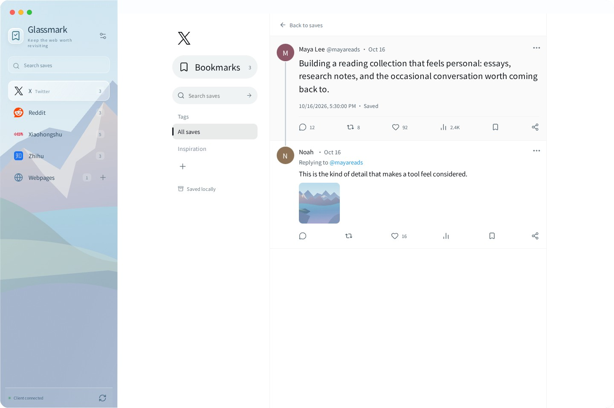
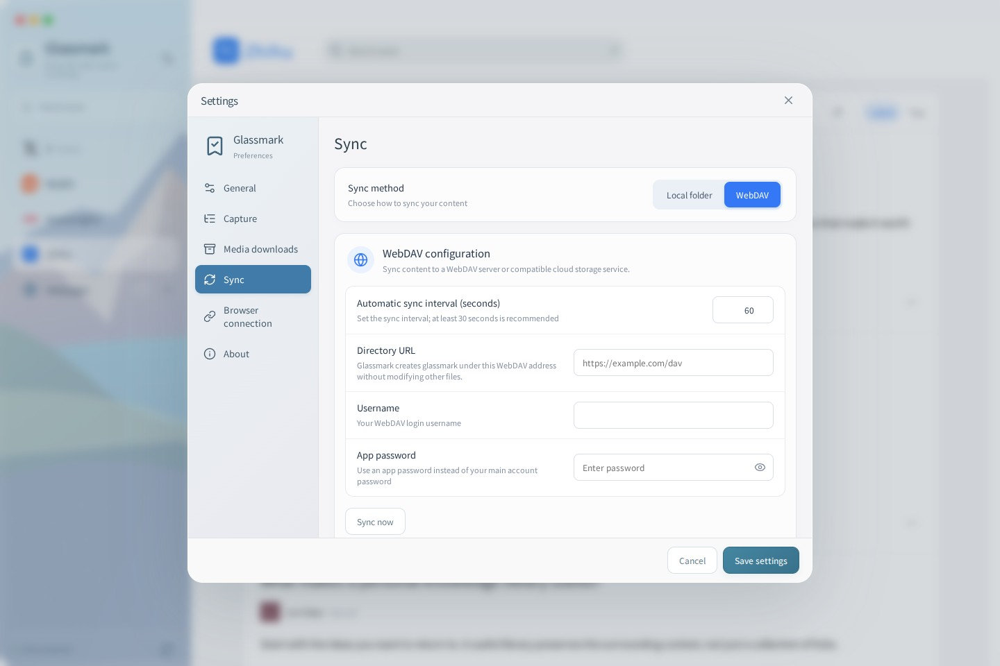
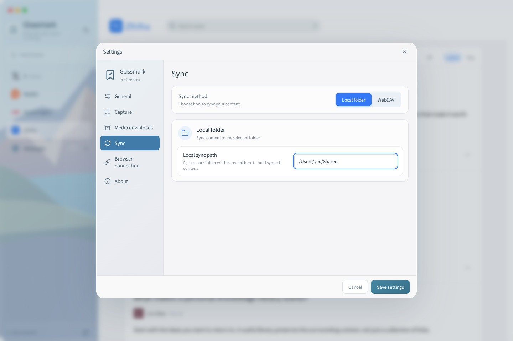

# Glassmark

**把值得回看的内容，留在手边。**

[下载最新版](https://github.com/kevinhuang001/bookmark-web/releases/latest) · [English](README.md) · [日本語](README.ja.md)

Glassmark 是一个本地优先的网页与帖子收藏工具。保存正文、对话和媒体，在安静的界面里慢慢阅读。

## 收藏之后，依然好读

- **网页沉浸阅读**：保存整页或多个选区，保留排版，把空间留给正文。
- **熟悉的平台界面**：X 书签时间线、Reddit 社区与层级评论、小红书封面瀑布流与双栏阅读、知乎回答与专栏文章阅读。
- **内容保存在本机**：图片、头像、GIF 和支持的视频一起归档，不只是留下一个链接。
- **整理和查找**：嵌套文件夹、独立标签、全局搜索与平台内搜索。
- **自己选择同步方式**：本地文件夹或 HTTP/HTTPS WebDAV，无需注册 Glassmark 账户。
- **多语言界面**：英语、简体中文和日语，可跟随系统。扩展跟随客户端语言，收藏内容保持原文。

知乎问题页或回答页先在扩展中选择一个回答；扩展会自动打开评论并等待加载。专栏文章直接收藏。使用 ⌘/Ctrl + K 搜索，Esc 返回平台收藏列表。

X 根据已识别的真实父帖 ID 绘制回复连线。点击评论按钮原地展开，不跳转页面。四个平台的评论图片和视频默认显示小缩略图，点击后放大浏览或播放；支持前后切换及方向键。

小红书会读取当前笔记的页面媒体清单，并遍历虚拟轮播；X 会补读当前帖子的媒体与回复数据，避免只保存最初显示的一张图。多个视频保留各自的播放源。受限或未暴露下载地址的媒体仍受保存范围限制；旧收藏漏掉的文件需要重新收藏。

## 开始使用

1. 在[发布页](https://github.com/kevinhuang001/bookmark-web/releases/latest)下载 macOS、Windows 或 Linux 客户端和对应浏览器扩展。
2. 启动客户端，打开「设置 → 浏览器连接」，复制配对码。
3. 在扩展中粘贴配对码，然后打开网页或帖子详情页进行收藏。
4. 回到客户端阅读、搜索、编辑标签和整理文件夹。

Chromium 扩展解压后通过扩展管理页的开发者模式加载。Firefox 通过 `about:debugging` 临时加载，重启浏览器后需要重新加载。收藏期间保持客户端运行。

在「设置 → 通用 → 语言」切换界面语言。通用、内容收藏、媒体下载、同步、浏览器连接和关于采用统一的分组卡片样式。

## 同步

在「设置 → 同步」选择本地文件夹或 WebDAV，填写目的地并保存；选择哪种方式就使用哪种，没有额外的 Enable sync 开关。

- **本地文件夹**：只配置绝对路径。修改后自动复制内容，每五秒检查传入内容，不显示同步周期、立即同步或冲突区域。
- **WebDAV**：配置 HTTP/HTTPS 地址、用户名、应用密码和自动同步周期；「立即同步」与「同步冲突」都在 WebDAV 配置卡片内。

两种方式都只在所选目的地下创建一层 `glassmark/`，其下直接保存事件和归档，不再嵌套 `content-v2/`。本机应用内部的数据目录仍使用 `content-v2/`，不属于同步目标路径。

保存范围以页面已经加载和能够访问的内容为准。支持直接 MP4/WebM 及未加密的有限 HLS 点播；不支持 DRM 和直播完整归档。每次收藏可查看媒体保存报告。

截图使用示例内容。更完整的安装和产品介绍见 [English README](README.md)。

[使用指南](docs/USER-GUIDE.md) · [参与开发](CONTRIBUTING.md) · [MIT 许可](LICENSE)

Linux x64 提供 DEB（Ubuntu / Debian）、RPM（Fedora / openSUSE）、Arch 的 `.pkg.tar.zst` 和通用 AppImage。二进制以 Ubuntu 24.04 为构建基线，要求 glibc 2.39+ 与 WebKitGTK 4.1。Release 下载区只保留安装包、扩展和校验文件，JSON 测试报告位于 CI 附件。
